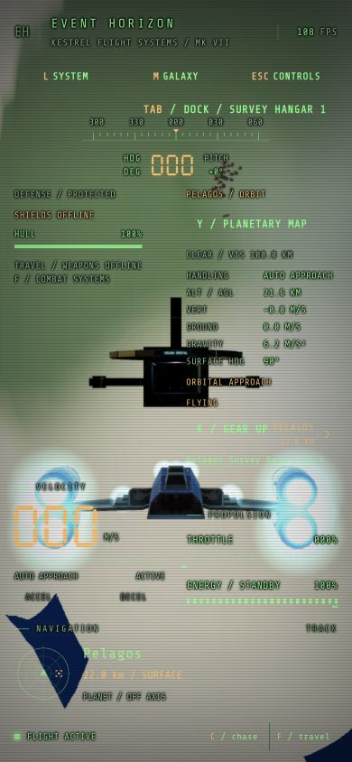

# Travel, Combat and contextual controls

F switches between two stabilized flight modes. The ship starts in Combat. Both modes retain
angular damping, drift damping, gravity compensation and automatic gear leveling. Switching modes
clears held fire and weapon charge; it never repairs the hull, restores shields or refills energy.

| Capability                 | Travel                           | Combat                                        |
| -------------------------- | -------------------------------- | --------------------------------------------- |
| Stabilized handling        | Enabled                          | Enabled                                       |
| Clear-space cruise / boost | Up to 5.94 / 11.88 km/s          | 180 / 360 m/s                                 |
| Weapons and combat locks   | Offline                          | Enabled within combat speed and energy limits |
| Shields                    | Offline; stored charge preserved | Enabled while energy is available             |
| Energy consumption         | None                             | Weapons, shields and boost share one reserve  |
| Hull vulnerability         | Damage still applies             | Damage applies after active shields           |

Travel speed ramps down near atmospheres, terrain, stations and nearby traffic. Planetary approach
uses the existing forward sweeps and stopping-distance envelope, capped at 1.4 km/s. Deploying gear
also limits speed. O and the separate approach/transit toggle are removed. Selecting Combat at high
speed brakes continuously at up to 600 m/s²; weapons stay locked above 361 m/s. No mode switch
teleports the ship or changes its position.

G now owns landing, docking, takeoff and undocking (see README). Internal surface coasting remains available to shared simulation commands. This is automatic handling
inside either flight mode. Release retains radial motion, S brakes, and W returns to forward flight.
Travel allows the existing 800 m/s descent envelope; Combat limits surface jets to 360 m/s. Terrain
and gear braking remain active in both modes. Landing, docking, takeoff and hyperspace remain
physical operations with their existing validation and cancellation paths.

## Shared combat energy

The existing engine reserve now supplies all combat systems; the HUD labels it ENERGY. The complete
authoritative reserve, recharge delay and boost exhaustion latch remain in flight snapshots (the
transport fields retain the names `boostCharge`, `boostDelay` and `boostExhausted`). Prediction replays
flight and boost only; weapons and shield spending come from authoritative snapshots.

Gun shots cost 4%, missiles 18%, railgun shots 30% and flak salvos 12%. Synchronized guns pay per
projectile. Boost consumes 25% per second. Active shields consume 2% per second and regeneration
costs 0.4% per restored shield point. Weapons and boost delay recharge by 1.2 seconds; reserve then
recharges at 14% per second. Shield upkeep and regeneration do not restart that delay. Spending and
regeneration are bounded by available energy. Weapon heat and cooldowns remain independent limits.
Travel consumes no reserve, including while boosting, and can recharge existing reserve.

## Tab confirms the suggested action

The HUD shows the current suggestion. Tab or its HUD button confirms one action:

- A landed ship takes off; a docked ship undocks.
- An existing docking approach runs automatically. A second G or Tab cancels it; secured
  undocking runs to completion.
- In Combat, acquire the nearest hostile ahead, fall back to a nearby hostile, or cycle the current
  target. Existing missile cone/range validation then provides automatic lock.
- In Travel, offer a nearby free berth, otherwise a validated landing zone. Active landing
  assistance offers cancellation.
- When no local operation is available, suggest a navigation contact ahead of the ship, with a
  nearby-contact fallback. Repeated presses skip the current navigation target.

Suggestions publish with the existing 10 Hz HUD snapshots and never move the ship themselves.
Every docking/landing intention is revalidated by the shared authority. Tab retains ordinary focus
navigation in maps, text fields and focused buttons/links; Shift+Tab also retains focus navigation.
G handles gear procedures in either mode, selecting a free nearby berth or valid landing zone.
It confirms takeoff/undock when secured and cancels an unfinished approach on a second press.
R/V/K/U/P/I/J are retired. N cycles hostiles; X clears combat and navigation targets.
Tab still offers contextual suggestions and retains normal map/button focus navigation.

## Authority and verification

Protocol v6 carries the validated `flightMode` intention and complete authoritative mode/reserve
state. The old transit action and client assistance boolean are rejected. Internal `travelMode`
records automatic forward/transit/surface handling for reconciliation. Traffic clearance is a
bounded authoritative scalar in full snapshots. Client and server builds must update together.

Behavior tests cover stabilization, speed changes and weapon locking, all four weapons, shared
energy spending and regeneration, unshielded Travel hull damage, delayed reconciliation, neutral
timeouts, contextual suggestions and keyboard focus. Real-socket tests cover replicated modes and
surface coasting. The complete `npm run check` passed: lint, 543 tests, typecheck and production
build. The nine real-socket integration tests passed, including explicit Travel power-down/Combat energy coverage.

Browser checks used Chrome at 1920×1080, 390×844 and 390×600 CSS pixels. Checked F switching,
Travel offline indicators, Tab docking and cancellation, map Tab focus and prompt suppression,
both cameras, the Solara → Vesper → Aether → Solara route, charge abort and reset. No warnings or
errors were captured in the browser console. These checks used ordinary UI controls, without
fixture placement. Native pointer lock, audio perception and a new 60-second GPU frame profile
were not tested for this change.

Load checks used an Apple M2 Pro with 32 GiB RAM, Node 22.20.0, one process for the server and real
SDK bots, and local loopback with no injected latency. The space-combat run lasted ten seconds per
population; low-altitude, station and descent runs lasted five seconds per population in each mode.
All 2/8/16-client results, including binary upload/download, acknowledgement latency, CPU, RSS and
overruns, are saved in [the measurement record](benchmarks/flight-modes-2026-11-02.json).
Sixteen-client summaries follow; upload was 4.1–4.6 KiB/s per client.

| Scenario     | Mode   | Mean / max tick ms | Down KiB/s per client | p95 ack ms | CPU % of one core | RSS MiB | Overruns |
| ------------ | ------ | ------------------ | --------------------- | ---------- | ----------------- | ------- | -------- |
| space-combat | combat | 8.344 / 121.59     | 566.2                 | 71         | 40                | 144.7   | 2        |
| low          | combat | 5.880 / 11.34      | 407.2                 | 33         | 37.8              | 162.8   | 0        |
| station      | combat | 7.290 / 16.22      | 615.2                 | 34         | 40.5              | 193.3   | 0        |
| descent      | combat | 3.588 / 8.96       | 245.9                 | 43         | 24.9              | 154.2   | 0        |
| low          | travel | 5.141 / 70.56      | 251.7                 | 59         | 27.9              | 148.6   | 1        |
| station      | travel | 4.488 / 8.83       | 248.3                 | 45         | 28.3              | 153.5   | 0        |
| descent      | travel | 4.642 / 10.03      | 248.4                 | 47         | 30                | 172.7   | 0        |

The space-combat sixteen-client run recorded two overruns and a 121.59 ms maximum tick. The
sixteen-client low-altitude Travel run recorded one overrun and a 70.56 ms maximum tick. Other runs
recorded zero overruns. Browser work overlapped these measurements; integration tests also ran
during the space-combat measurement. These short local tests establish neither sustained capacity
nor Internet or renderer performance. Earlier descent timing records apply to their earlier tuning;
Combat now has a lower surface speed cap, while Travel retains the faster descent envelope.

