# Hyperspace — safety, pacing and flight guidance

Galactic coordinates are light years. Heading and distance come from the same catalogue positions;
local flight and collision coordinates remain metres. Transit lasts `3.4 + distance × 0.12` seconds.
Charge, entry stretch and exit add 3.2, 3.4 and 2.1 seconds respectively. Cooldown is another four
seconds after keyboard flight returns. For example, Solara → Vesper is 48.5 LY and about 17.9 seconds
before control returns; Solara → Aether is 63.0 LY and about 19.7 seconds. Preparation/readiness holds
can extend those estimates.

The live lane map stays visible through charge, stretch, transit and exit. It replaces the telemetry
panel with a route-relative galactic chart: departure/destination beacons, nearby systems, a traveled
trail, distance ticks, range rings and a moving Kestrel marker. Galactic coordinates supply the
projection; lateral context is foreshortened for an oblique schematic. Neighboring dots are catalogue
systems, not intermediate stops or newly invented connections. Range rings mark quarter/half of
the route distance around the current position.

The marker uses traveled light years rather than elapsed cinematic time: it stays at departure during
charge/stretch, crosses the lane during transit and remains at destination during arrival. Distance,
ETA, phase and Abort / Esc remain legible beside the map. Wide layouts place it at the lower right;
narrow layouts use a compact bottom chart. The existing 10 Hz snapshot drives it, with a short marker
interpolation suppressed for reduced motion and holds. No animation timer, network field or flight
state was added. Arrival waits display HOLD. Explicit focus/visibility suspension freezes the map
behind the existing resume/abort prompt. The bounded-delta clock prevents a suspended tab from
skipping the journey.

## Departing near a planet or facility

Charge first chooses a clear local launch bearing: the galactic bearing, then at most forty cone
headings and a reverse bearing. Every candidate checks the full 1,800 km sweep. A planet beside the
ship can sweep out of view during the burst; heading settles onto the galactic arrival direction
under full tunnel coverage. The client and server share this bounded search.

A plan still blocked by an atmosphere/facility closes the chart and returns to keyboard flight.
An amber bearing and distance point toward a clear launch waypoint. Follow the route using normal
controls; V/R remain planet-relative near a landable body. A clear lane offers Tab or the Engage
button. Confirmation remains available
until conditions change; there is no quick-time deadline or automatic launch. The destination stays
selected and every confirmation rechecks clearance. No multiplayer permit is requested while blocked.

The pure escape planner compares ten bounded boundary candidates per attempt, preferring a short
outward escape that permits a clear launch heading before trying the full departure capsule. It
rejects obstructed local flight segments and chooses the shortest safe candidate found. It refreshes
after 0.5 seconds or 500 m of movement. This is a local escape planner, not a global optimal pathfinder;
overlapping facilities may require manual repositioning. If no candidate is available the HUD requests outward flight while it
recalculates. Suggestions never steer, teleport, or author authority coordinates.

Below 1100 CSS pixels the bearing becomes a compact banner, leaving hull and altitude instruments
unobstructed. Ordinary body markers and the duplicate Tab prompt yield to launch guidance. Detailed
guidance and a bounded screen bearing remain available on larger viewports.

## Collision and transition guarantees

- Departure validates the whole 1,800 km cinematic sweep and the source-side transit/preparation window.
- Bounds include maximum terrain/engineered foundation height, physical atmosphere height, rings,
  camera margin and orbital motion of every ancestor. Moving/rotating facilities use cached collision
  extents and conservative motion bounds.
- Arrival validates both sides of the holding point, including the backwards client lead-in and
  authoritative occupied-spawn offsets. Receiver clearance includes the remaining distance-scaled
  transit, readiness timeout and exit. Corridors are checked again at commit and confirmation.
- Preparation and destination-frame readiness retain independent twelve-second timeouts. The system
  switches under full tunnel coverage; a stale source frame cannot reveal the destination.
- Offline cancellation before commit keeps the source; multiplayer cancellation before admission
  keeps the source. After admission/commit, the existing recovery path keeps a safe destination. Health, reserve, statistics, camera and validated input ownership remain
  on their existing authority paths. Matching updated client/server code is required; no new wire
  fields or protocol version are introduced by this iteration.

## Cinematic presentation

Real-space motion uses the game's compressed world scale. Departure covers 1,800 km with an
eighth-power ease-in after ignition: very little initial movement, then a steep late burst. Arrival
retains 800 km/s through the world reveal, then brakes over the final 0.63 seconds with a ninth-power
velocity falloff. Both offline and online journeys use a near-planet endpoint with the derived
1,226 km coast behind it; normal flight resumes at exactly 100 m/s. Bodies grow and move across the
view from actual ship translation. The physics integrator never receives cinematic speeds. The
requested [supercut moments](https://www.youtube.com/watch?v=qckDs0ODemg&t=142s) were inspected in the
browser; film footage is not bundled.

The persistent 12,000-star field supplies every streak. Wider white cores, cyan shoulders and blue
halos build to full stretch by 36% of entry. Tunnel coverage starts at 80%, leaving about 1.5 seconds
of fully extended stars. Stretched exposures share the tunnel's logarithmic 80 m optical boundary;
ordinary stars remain behind celestial geometry. Hull, cockpit and exhaust retain foreground depth.

Trails crossfade directly into three irregular cloud shells. Tunnel opacity follows world coverage;
a restrained light crest brightens cloud detail without a separate pale blue/white overlay. Exit
brings fully glowing trails up over the opaque mask during its first 30%, holds full extension until
50%, then contracts through 94%. Star travel settles earlier, by 45%, so the field is already visible
when contraction begins. Exit stays opaque through 30%, then reveals the destination over 30–70%:
about 0.84 seconds. Optical trails cannot release the world mask. The analytical coast still ends at
exactly 100 m/s. Seeded smooth noise varies camera translation/rotation, cloud drift and reflected
light between journeys. Camera/tunnel turbulence occurs in brief 0.45–0.7 second hiccups, with
seeded onset times and at least two seconds of complete rest between events. All camera axes share
the same event envelope, so most cruise is fully steady. Entry/exit recoil remains separate.
Impulses are removed before the next camera update and never feed physics.

Three cloud scales now provide broad dark folds, creased wisps and fine luminous filaments on
far-to-near shells. Blue light pools pulse and drift around the walls; the same explicit clock and
sample drive a moving spotlight and dim opposite fill on the ship. System light fades with tunnel
coverage, letting the hull, wings and canopy cast readable moving shadows. A single 512×512 soft
shadow map covers only the visible player hull/cockpit, with a 32 m light frustum. Its depth material
uses projected light depth to avoid logarithmic-depth shadow artifacts. The map is retained across
jumps, freezes on journey holds and has no normal-flight shadow pass; Fiber disposes it on teardown.

Cloud features now travel from the vanishing point toward the camera, expanding outward instead of
receding into the center. The texture scroll clock is negative; bends move with the sampled cloud
field. Wall coordinates turn clockwise at 0.2 rad/s (about 11.5°/s), with a single CPU-computed
sine/cosine pair reused by the shader. The camera retains its occasional hiccups. Reduced motion
freezes both cloud travel and spin, and neither has an independent animation clock.

Reduced motion suppresses trails, turbulence, recoil, dynamic FOV, exposure, animated clouds and
moving highlights, retaining steady blue illumination. No particle stream, asset textures,
dependencies or audio assets were added. Normal-flight audio ownership and gestures are unchanged.

The visual direction follows the requested modern-film cues: screen-filling white/cyan streaks,
blue cloud depth and illuminated foreground surfaces. Inspected primary references were the
[official Solo gallery](https://www.starwars.com/films/solo-a-star-wars-story-gallery) and
[Rob Bredow's production discussion](https://www.starwars.com/news/rob-bredow-making-solo-book-interview).
The effect is an original procedural interpretation; film images/footage are not bundled.
The [requested Andor clip at 0:07](https://www.youtube.com/watch?v=_y92SdOjJ2M&t=7s) was also inspected
in the browser for cloud detail, blue pulses and directional hull illumination.

## Browser verification — 2 November 2026

Chrome checks used 1920×1080, 390×844 and 390×600 CSS viewports, with DPR 1 confirmed from the DOM
and canvas dimensions. Both chase and cockpit views completed Solara → Vesper → Aether → Solara.
Checked source alignment, entry/transit/exit, ship/cockpit visibility, route telemetry, map suppression,
map Tab focus, reset and abort. Console warning/error queries returned no entries.

The departure loop used ordinary UI controls with a finite practice encounter selected: descend at
Pelagos with V, request Vesper, receive a roughly 5.8 km blocked-lane waypoint, climb with R, observe
LAUNCH LANE CLEAR, and confirm with Tab. No QA placement or game-state injection was used. The
390×600 banner ended at y=172; hull/planetary instruments began at y=192, with altitude at y=234 and
no horizontal overflow. Pausing preserved the plan; cancellation/reset cleared it.

Native pointer capture, audible mix assessment, an OS reduced-motion browser pass, long live
multiplayer focus suspensions, simultaneous transfer saturation and a new sixty-second GPU frame
profile were not exercised. Camera/reduced-motion and async lifecycle behavior have unit coverage.
FPS readouts in screenshots are observations on this machine, not a hardware guarantee.

The visual follow-up at `248a750` repeated Solara → Vesper → Aether → Solara using ordinary UI
controls: chase at 1920×1080 and cockpit at 390×600, with no horizontal overflow. Captured entry/exit
frames confirm overlapping cloud detail and bright exit streaks, with hull/canopy preserved. Map Tab
focus, abort during the blend and reset were checked; console warning/error queries remained empty.
The cloud-blend and exit-glow screenshots below record that follow-up. That visual-only follow-up
did not rerun multiplayer load or a sustained GPU profile; the later real-space measurements are below.

The real-space pass completed Solara → Vesper → Aether → Solara at `9cf141e`, using chase at
1920×1080 and cockpit at both 1920×1080 and 390×600. The sharper `b6ed3b9` easing then repeated
Solara → Vesper in chase and cockpit, including the compact viewport, with no horizontal overflow
or console warnings/errors. Abort during the moving departure, reset and map Tab focus were checked
before the exponent-only follow-up. All travel used ordinary UI controls, without placement fixtures
or game-state injection. The two real-space screenshots show the final sharper cockpit approach.

## Automated and load verification

The forward-flow/swirl follow-up at `1b85b53` passed `npm run check`: lint, **574 tests across 43
files**, TypeScript checking and production build, including the nine real-socket integrations.
New tests cover outward feature projection on all three shells, continuous spin across angle wraps,
held clocks and reduced-motion suppression.

Chrome completed Solara → Vesper → Aether → Solara in chase/cockpit views, at 1920×1080 and
390×600 CSS. Successive chase frames were inspected for outward travel and clockwise rotation.
The compact view had no horizontal overflow; map keyboard focus, abort/reset and an empty
warning/error console were checked. Browser suspension and the OS reduced-motion preference were
not rechecked; their motion samples are covered by tests. No new GPU benchmark or multiplayer
browser measurement was made; earlier measurements retain their stated revisions and limits.

The live lane-map follow-up at `4586e8f` passed `npm run check`: lint, **571 tests across 42 files**, TypeScript
checking and production build, including the nine real-socket integrations. New pure tests cover
all ninety directed route frames, reversed and vertical projections, galactic altitude, safe
degenerate input and bounded distance progress. Existing transaction tests cover frozen read models
on hold and retained source identity through arrival.

Chrome completed Solara → Vesper → Aether → Solara through the ordinary UI in chase/cockpit views.
The DOM progress stayed at zero while charging and advanced from 30.5% to 55.4% during transit.
Both 1920×1080 and 390×600 layouts rendered; the compact view had no horizontal overflow. Map Tab
focus, abort/removal, reset and the warning/error console were checked. Browser suspension/resume
was not successfully revalidated by this automation; hold behavior is covered at the read-model
boundary. No new performance or multiplayer browser measurement was made; the earlier records below
retain their stated revisions and limits.

The occasional-hiccup follow-up passed `npm run check`: lint, **568 tests across 41 files**,
TypeScript checking and production build. Regression checks cover brief events, multi-second gaps,
over 80% calm cruise, smooth boundaries, per-journey variation and an exactly steady cockpit between
events, including held-clock nonaccumulation and reduced-motion suppression.
Chrome completed Solara → Vesper → Aether → Solara across chase/cockpit views, including 390×600
without horizontal overflow. Map focus, abort/reset and a clean warning/error console were checked
through ordinary UI controls. No new performance capture or multiplayer browser run was performed;
the renderer/load records below retain their stated revisions and limits.

The tunnel-lighting follow-up at `607006a` passed `npm run check`: lint, **566 tests across 41 files**,
TypeScript checking and production build, including the nine real-socket integration tests. New
behavior tests cover bounded/smooth light pulses and steady reduced-motion/held-clock samples.
Chrome completed Solara → Vesper → Aether → Solara in chase and Aether → Solara in cockpit after
the shadow-depth correction. The 390×600 view retained its hull/HUD without horizontal overflow;
abort and reset removed the tunnel and restored normal lighting. Console warnings/errors were empty.
OS reduced-motion rendering and a multiplayer browser jump were not rechecked in this presentation
iteration; deterministic reduced-motion samples are covered by tests.

A 60-second foreground Chrome sample at 1920×1080 CSS / DPR 1.5 (2880×1620 canvas) on an Apple
M2 Pro / 32 GiB recorded **10.5 / 17.2 / 21.9 ms p50 / p95 / p99**, 5,368 frames, valid/complete.
It mixed Vesper → Aether → Solara journeys, normal flight and chart pauses with warm shader paths;
this is not an isolated tunnel GPU benchmark. No tests/load harness ran during capture. Main-scene
peaks were 55 draws / 325,114 triangles. Three resets those counters after the shadow pass; the
bounded extra pass adds one hull draw / 3,512 triangles or fourteen cockpit draws / 240 triangles,
still within the 180-draw / 350k reference budgets. Shadow color/depth storage adds roughly 2 MiB
outside the planetary allocation counter. An earlier cold development entry showed roughly 1.7 s
of visible clock lag during initialization; the cause was not isolated. That observation was not an
instrumented cold benchmark and is excluded from the warm sample. Results do not guarantee other hardware,
cold loading, high-detail cities or production builds. Raw capture data and conditions are in the
[tunnel-lighting measurement record](benchmarks/hyperspace-lighting-2026-11-02.json).

The preceding real-space iteration passed lint, **564 tests across 40 files**, TypeScript checking
and production build, including all nine real-socket integration tests. Coverage includes all ninety directed
catalogue routes, distance/progress clocks, receiver lead-ins and holds, future moon/facility
incursions, camera continuity and nonaccumulation, seeded turbulence, input/focus and cancellation.
The visual regression tests also check entry overlap, early exit glow, its visible full-stretch hold
and continuous optical visibility across phase boundaries.
Real-space regressions cover late acceleration, fast coasting through reveal, heavy visible braking,
the exact endpoint/velocity handoff, planet angular movement, clear launch bearings, short atmosphere
escapes and camera following across 100 km render-origin steps.
Vite retains its existing large-chunk advisory.

The preceding code revision `b6ed3b9` was measured on an Apple M2 Pro with 32 GiB RAM and Node
22.20.0. These three-second Combat join/combat runs used real SDK clients and the server in one
process on loopback, with no injected latency. QA Chrome tabs were closed; neither browser automation
nor the test suite ran during measurement. Binary rates exclude WebSocket/TCP headers. Full data,
actual tick rates and the pre-tuning sample are in
[the real-space measurement record](benchmarks/hyperspace-realspace-2026-11-02.json).
The [earlier hyperspace record](benchmarks/hyperspace-2026-11-02.json) remains at its stated revision.

| Clients | Mean / max tick ms | Down / up KiB/s per client | p95 ack ms | CPU % of one core | RSS MiB | Overruns |
| ------- | ------------------ | -------------------------- | ---------- | ----------------- | ------- | -------- |
| 2       | 3.332 / 7.63       | 193.2 / 4.5                | 23         | 22.5              | 173.5   | 0        |
| 8       | 6.283 / 11.98      | 443.1 / 4.5                | 35         | 34.9              | 186.8   | 0        |
| 16      | 9.612 / 15.88      | 713.7 / 4.5                | 56         | 51.9              | 177.8   | 0        |

A pre-tuning run at `9cf141e` recorded one 16-client overrun with a 43.59 ms maximum tick; the final
sample recorded none. Both runs are retained. These short samples do not establish sustained capacity,
Internet latency, renderer performance or simultaneous-transfer capacity, and do not profile the
departure-heading search under transfer saturation. Transfer behavior is covered by
real-socket integration tests; moving-boundary and extended receiver-window regressions are headless.

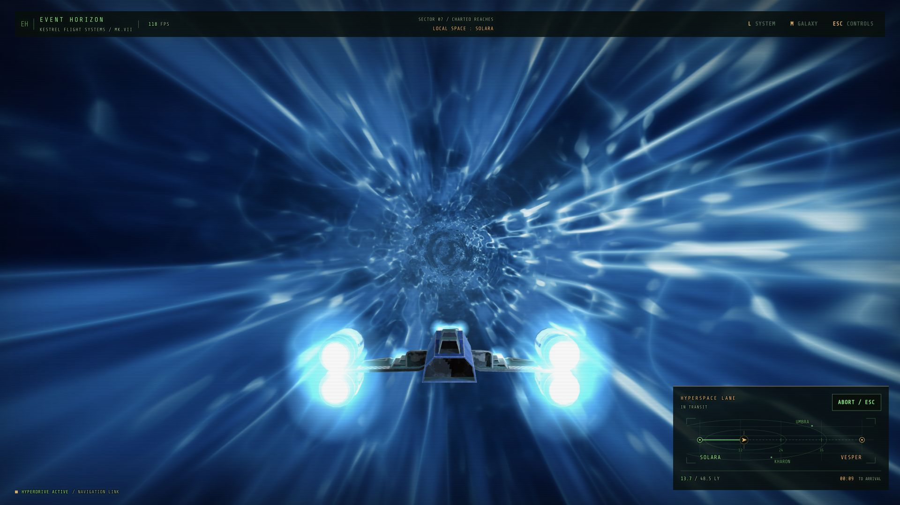

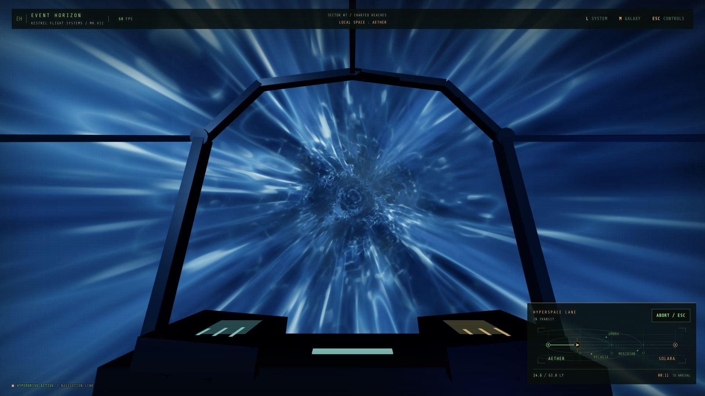

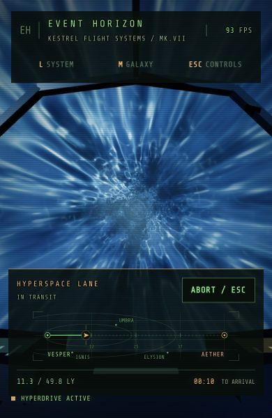

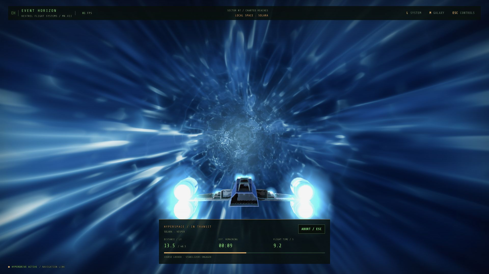

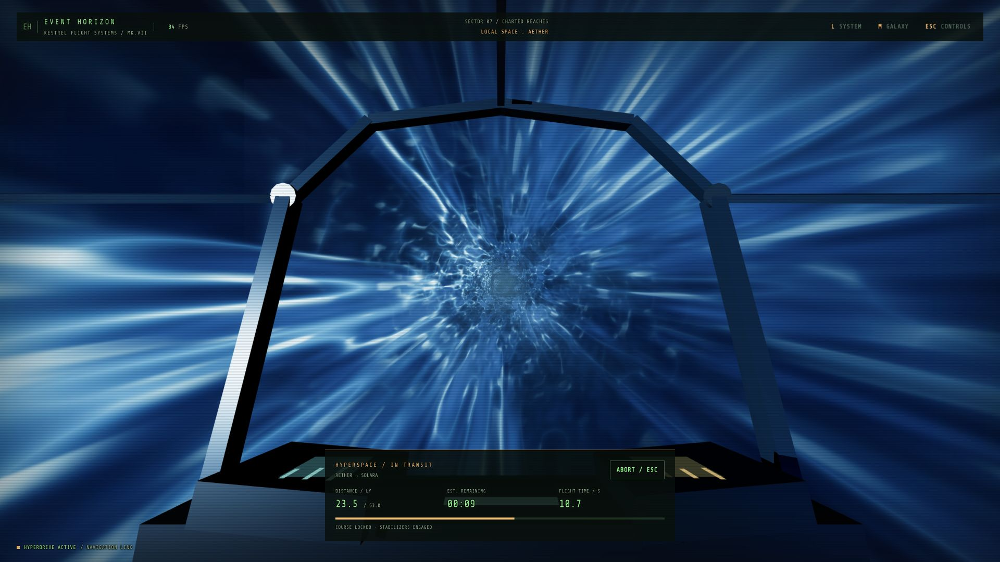

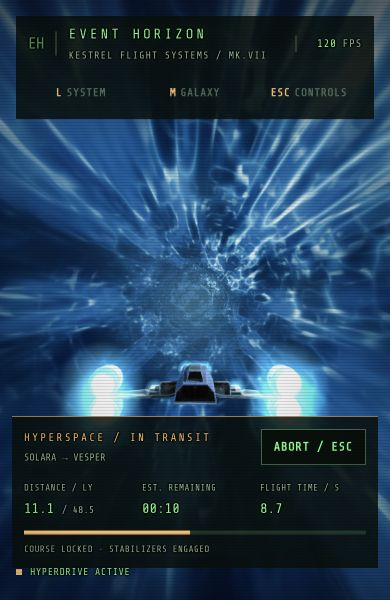

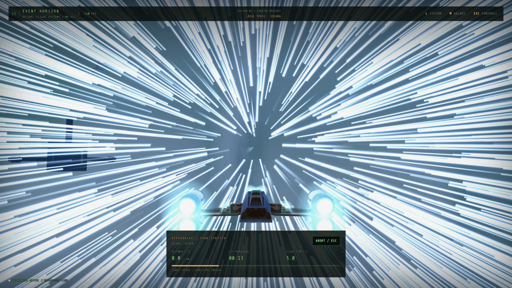

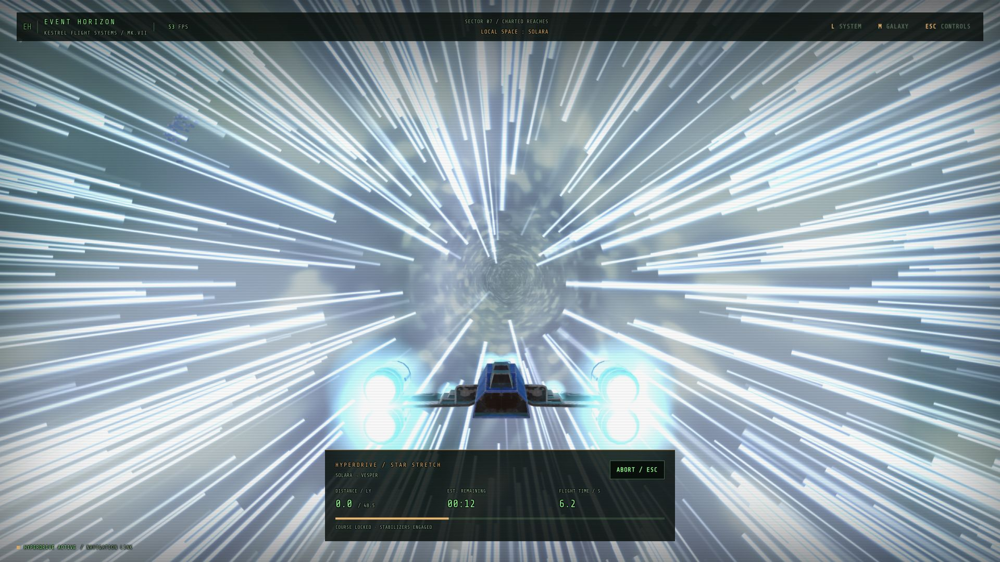

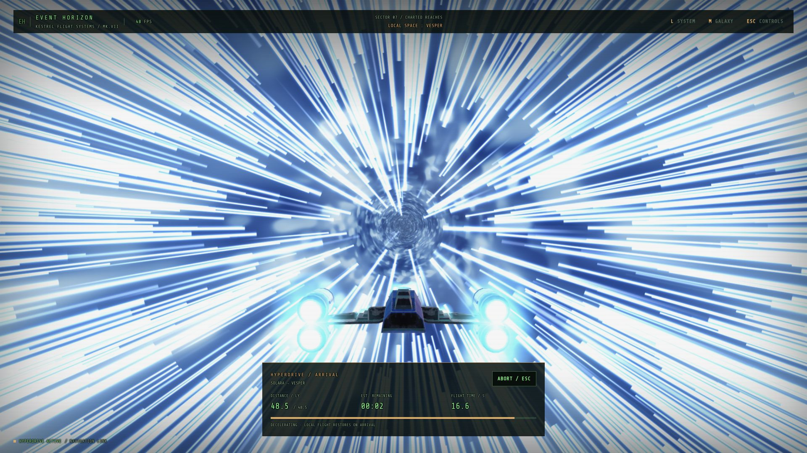

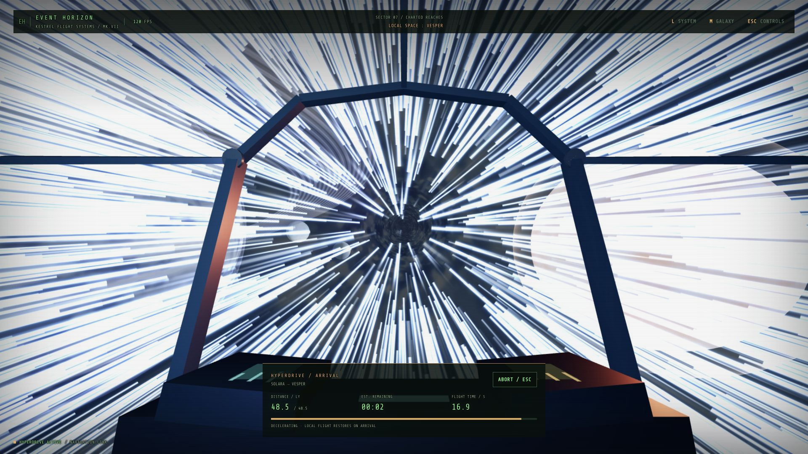

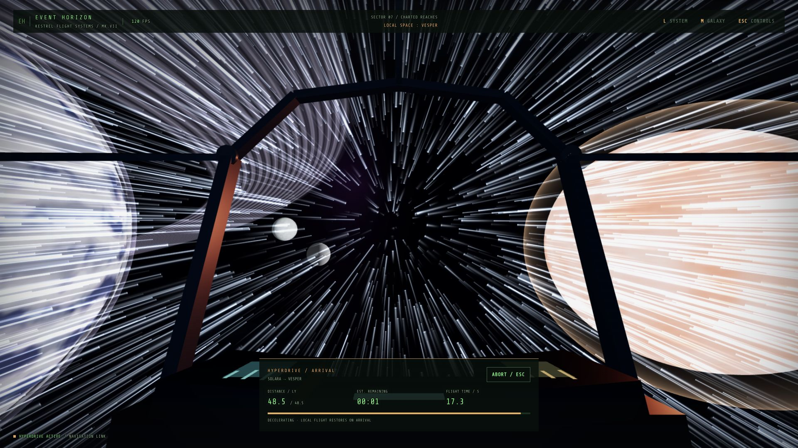

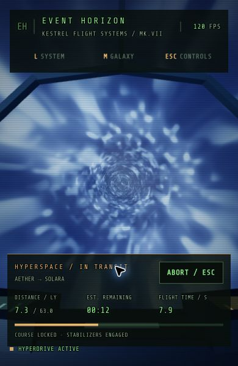

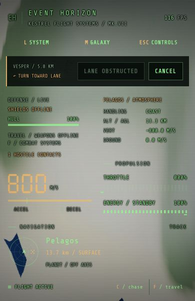
