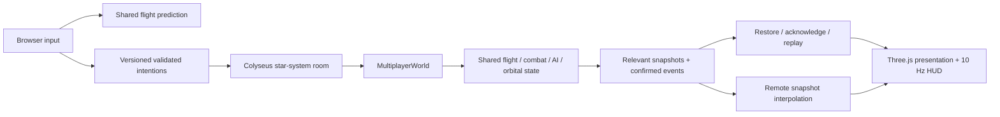

# Multiplayer authority, PvP and cooperative PvE

This is the current multiplayer contract. The Milestone 4 record remains a historical acceptance
record for the offline game. The original implementation had reusable commands, deterministic flight,
continuous sphere collisions, weapons, damage, AI, orbital definitions and a cancellable cinematic.
It had no transport, server rooms, guest lifecycle, prediction or authoritative travel. Its simulation
used Three.js math. Milestone 5 extends those systems with shared renderer-independent math and a
Colyseus authority; it retains the offline game and the existing React/Three.js presentation.

## Run locally

Use the Node/npm prerequisites from the README. After `npm ci`, run these in separate terminals:

```bash
npm run server
npm run dev
```

Open `http://127.0.0.1:43170` in two tabs or windows. The authority listens at
`ws://127.0.0.1:43172`. Enter different callsigns in the flight briefing and choose
**Connect multiplayer**, then **Keyboard flight**. Both guests join the public Solara instance. The
room starts its arrival patrol after eight seconds of engaged controls. Practice target starts a
stationary shared enemy instead. Use G to acquire ahead, N/Tab to cycle ships, Space/left mouse to
fire, 1–4 to select weapons, and C for cameras. Remote pilot markers include names and distance.
PvP is enabled between guests; hostiles do not damage other hostiles. The existing cannon heat,
missile, railgun, flak, sphere collision and shield/hull rules all run on the server.

The HUD shows connection, pilot count, session kills/deaths and errors. Escape opens controls;
Disconnect is available in the briefing and the flight/death HUD. **Menus, charts and focus loss
release your controls and send neutral input; they do not pause the multiplayer world or prevent
incoming damage.** Respawn is a server request, permitted only for a destroyed ship. It restores
keyboard flight at a clear arrival with three seconds of protection. Reset flight remains an offline
action; it cannot reset a live authoritative ship.

Choose Vesper/Aether in the galaxy chart and engage hyperdrive. The server checks the ship, route,
cooldown and swept departure corridor. The existing cinematic prepares the destination under its
opaque tunnel, obtains destination authority, waits for the destination scene's first frame, then
restores keyboard control. Other pilots stay in their current room. Guests arriving in the same
non-full public instance meet again. A full room creates another instance, identified by Colyseus
room ID. The wire `instanceId` is that unique room ID; the join option `instanceId: public`
selects the matchmaking pool, independently of the actual instance identity.

Copy `.env.example` to `.env` for local overrides; it is ignored by Git. Vite reads the public
`VITE_` settings and `npm run server` reads the Node settings. Restart after changing configuration.
If changing `SERVER_PORT`, set `VITE_MULTIPLAYER_URL` to the matching address. Update both values in
any existing `.env` that still uses the previous port `2567`. The web development server uses `43170`
and `npm run preview` uses `43171`; both exit if their selected port is busy. Override them with
`npm run dev -- --port 43270` or `npm run preview -- --port 43271`.
The default endpoint is loopback, never a production endpoint. Deploy the client as static `dist/`
assets and run the Node authority separately; use a TLS WebSocket endpoint for an HTTPS client.
`npm run server:dev` watches server/shared files. Normal `npm run dev` remains fully usable offline.

| Setting                      | Default                | Meaning                                             |
| ---------------------------- | ---------------------- | --------------------------------------------------- |
| `VITE_MULTIPLAYER_URL`       | `ws://127.0.0.1:43172` | Public server address                               |
| `VITE_INTERPOLATION_MS`      | 100                    | Remote buffer delay, bounded to 50–300 ms           |
| `SERVER_HOST`, `SERVER_PORT` | `127.0.0.1`, 43172     | Listening address                                   |
| `SERVER_TICK_RATE`           | 30                     | Fixed authority/input rate, 10–60 Hz                |
| `SERVER_SNAPSHOT_RATE`       | 20                     | Per-recipient snapshots; capped to tick rate        |
| `SERVER_CAPACITY`            | 16                     | Guests per room; configurable 2–32, tested up to 16 |
| `SERVER_RECONNECT_SECONDS`   | 15                     | Dropped guest reservation grace, 1–60 seconds       |
| `SERVER_RELEVANCE_METRES`    | 6000                   | Full-frequency nearby state, minimum 4000 m         |
| `SERVER_DEBUG`               | false                  | Five-second room metrics in the Node console        |

## Ownership and protocol



- `engine/math/linear.ts`: small tested vector/quaternion operations without renderer imports.
- `engine/simulation`, `physics`, `combat`, `world/SystemRuntime`, `navigation`: existing rules,
  shared tuning and catalogue. Authority has no Three.js, React, browser, store or feature imports.
  `world/RenderOrigin` is a client presentation utility and intentionally retains Three.js.
- `engine/network/protocol.ts`: one versioned Zod/TypeScript contract for join, input, actions,
  compact ship/projectile/effect state, attributed combat events and snapshots. No static ship or
  celestial definitions are sent every tick. Colyseus encodes messages with MessagePack.
- `engine/network/MultiplayerWorld.ts`: one system's players, shared encounters, safe spawn selection,
  nearest-live-player AI targeting, celestial collider updates, kills/deaths and authority snapshots.
- `server/createServer.ts`: Colyseus rooms, matching/capacity, guest IDs, tick/snapshot scheduling,
  reconnection reservations, travel permits, rate limits and measurements. Empty rooms dispose after
  guests/reservations expire; Colyseus adds an idle cleanup interval after failed reconnection.
- `features/multiplayer`: transport lifecycle, bounded development impairments, local prediction,
  authoritative presentation adaptation, remote interpolation and terminal UI. `FlightSession` is
  the explicit composition point with combat and exploration. It never steps local authoritative
  combat/AI while multiplayer is enabled.

Positions/velocity use metres and metres/second, rotations use normalized quaternions, angles use
radians, +Y is up and -Z is forward. Logical double-precision coordinates are independent of the
1024 m render-origin grid. The server owns analytical celestial time for every client in its room.
At the default 30 Hz each command runs four 120 Hz physics substeps, using the same flight integration
as client prediction. Other configured rates divide each authority tick into approximately 120 Hz
substeps, with the identical subdivision on predicting clients. Colyseus bounds fixed-tick catch-up
to five steps; packet arrival never advances simulation.

The join payload declares protocol version 5, callsign, system/instance and an optional single-use
travel ticket. Client messages are `input` or `action`; actions include travel, cancel-travel, ready,
respawn, encounter, gear, landing-assist zone/cancel, takeoff, docking request/capture/cancel,
undock, services and ping.
Server messages are welcome, snapshot (including confirmed combat
events and input acknowledgement), travel permit, error and pong. Unknown versions, extra input
properties, nonfinite/out-of-range axes and invalid weapons are rejected. WebSocket payloads are
limited to 4096 bytes inbound. Joins accept bounded plain callsigns, not HTML or client state.

Each player has an eight-command queue, monotonic sequence checks, a bounded forward sequence gap
and token-bucket limits (90 inputs/second, burst 30); Colyseus additionally caps total messages at
120/second. Actions have a separate five/second bucket with burst ten. Old/duplicate/out-of-order
commands are ignored. Commands time out to neutral after 250 ms, including lost focus or a dropped
connection. The server owns all movement, weapon origins/configuration/cooldowns/heat, targets,
collisions, damage and death. There is no client position/hit/damage message.

Snapshots include all near ships and combat targets at the configured rate, with distant ship states
once per second and a bounded membership roster for reliable removals. Projectiles, effects and combat events are
relevance-filtered, retaining the recipient’s own combat outcomes; static world definitions remain bundled. This is a distance filter, not a complex
spatial database. PvP shots and AI are shared. Confirmed effects have stable per-room IDs; audio
consumes each once, and resets its cursor on a new room. Prediction replays only flight inputs,
never weapon simulation or one-shot effects.

Local prediction assigns one sequence per authority tick, retains at most 120 commands, restores
complete authoritative flight state at an acknowledgement and replays newer inputs. Corrections
modify predicted physics immediately; bounded position error decays separately in presentation.
Local poses interpolate between predicted ticks. Remote ships use a 32-snapshot buffer, quaternion
interpolation, at most 150 ms extrapolation and a 250 m teleport threshold. Rendering never mutates
server state. No rewind/lag-compensated hit validation is implemented; projectile sweeps use current
server time, so high-latency aiming remains harder.

## Travel and guest recovery

A server-issued UUID guest ID remains stable during successful reconnection and transfer. The SDK's
rotating reconnect token is kept in per-tab session storage when available. Dropped ships become
neutral and remain vulnerable during grace. Duplicate/stale reconnect tokens cannot create a second
active guest. Expired tokens fall back to a fresh guest join. Explicit Disconnect removes the guest.
Identity, statistics, rooms and tickets are in process memory and are lost on server restart.

Travel tickets last 30 seconds, are destination-bound and consumed once. A source ship becomes
noncombatant while transferring, and a request starts a 13-second server cooldown, including aborted
requests, to prevent invulnerability toggling. The destination computes a clear route/spawn, carries
health, boost reserve, flight distance and statistics, removes the source ship and its projectiles/targets, and holds the new ship
until ready. Safe arrival checks include other ships and revalidate occupancy at release. Swept
clearance includes the backwards cinematic lead-in, spawn offsets, terrain, atmosphere, rings and
moving bodies/facilities. The receiver's time window includes the client's remaining distance-scaled
transit, scene-readiness wait and exit. A locally blocked course shows flight guidance before a
permit is requested; both client and authority recheck clearance at launch.
Before destination admission, failure/cancellation keeps the source. After admission, recovery holds
the destination; late cancelled preparation cannot revive a journey. Reconnection during a transfer
adopts the server's current system and releases the safe arrival hold. Client cinematics and audio
remain separate from authority and never determine damage or simulation timing.

## Debugging and tests

In development, enable Network diagnostics in the briefing (or `VITE_NETWORK_DEBUG=true`). It shows
RTT, snapshot age, server tick rate, client FPS, prediction correction count, player count and room /
system IDs. The controls and `VITE_NETWORK_LATENCY_MS`, `VITE_NETWORK_JITTER_MS`,
`VITE_NETWORK_LOSS_PERCENT` impair input and snapshots, with bounded timers. Reliable control/travel
messages remain deliverable. Simulate connection drop exercises SDK recovery. These settings and
the overlay are disabled in production. Interpolation delay is configurable independently.

```bash
npm run check              # Biome, all tests, strict client/server typing and production build
npm run test:integration   # Real Node server and Colyseus clients; no WebGL
npm run test:load          # 2, 8, 16 clients, ten seconds each
LOAD_LATENCY_MS=75 npm run test:load
LOAD_SECONDS=30 npm run test:load -- 8
```

See [Milestone 5 verification](milestone-5.md) for executed checks, browser evidence, actual load
measurements and verification limits. The load harness counts binary transport payload bytes (without
WebSocket/TCP framing), input acknowledgement delay, tick time/overruns, process CPU and RSS. CPU/RSS
include both bots and the server in one process. Short local measurements do not establish production
capacity or thousand-player support.

## Extension rules and remaining limits

Add gameplay rules to the shared engine first, expose bounded intentions through the protocol,
validate them in the room and test authoritative behavior with real clients. Add rendering/UI through
the client adapter. Never implement a browser-only authoritative weapon, AI spawn, travel pose or
health mutation. Extend archetypes through shared configuration and compact IDs/flags, not per-tick
configuration objects. Retain prediction state whenever adding flight-affecting properties.

This milestone targets small guest sessions. Public deployment needs TLS/origin policy, operational
monitoring, connection/admission limits and application identity appropriate to its use. Guests are
not authenticated accounts. There is no persistence, distributed room migration, sticky routing,
combat rewind, matchmaking party placement, delta-compressed state or long-duration WAN soak test.
Full rooms can place friends in separate instances. Snapshot bandwidth grows with nearby combat;
measure before increasing capacity. Remote labels are limited to ten nearby pilots and renderer
slots to 32 players plus ten AI. No cross-platform bitwise determinism is promised.

Milestones 6–7 extend this authority with planetary fields, landing, station docking/occupancy and
services. See [planetary architecture](planetary-exploration.md) and the
[dated acceptance record](milestones-6-7.md).
Next: Missions, Contracts & Player Progression.
Later: larger battles, squadrons, missions and persistent progression, backed by longer load tests
and smaller/delta snapshots rather than speculative distributed infrastructure.

Protocol v6 retains the planetary fields introduced in v4 and replicates body-local surface attachments, gear/travel-mode/flight-lock state,
per-ship docking phase and the shared bounded port roster. Landing, takeoff, docking, undocking and
free services are strict intentions validated by the same authority as combat. No client may send
poses, terrain outcomes, repair amounts or occupancy mutations.
Landing assist replicates a selected zone ID; shared physics computes the entire trajectory.
Manual input, pause/timeouts, disconnect and invalid capture conditions cancel it. Older clients and
servers must update together. The full snapshot owns `travelMode` (`normal`, `transit`, `surface`)
instead of the previous transit boolean. Only shared input/action processing selects it; clients
cannot assign that automatic handling or send pose mutations. The input carries only a validated
`flightMode` intention (`travel` or `combat`), which always enables stabilization. F selects that intention.
The old assistance boolean and transit action are rejected. Shared energy uses complete authoritative
reserve snapshots; prediction never replays weapons or shield spending. Released V/R retain
surface coasting; neutral/menu input does not erase inertia while the server advances.
See [approach verification](planetary-approach.md).


Surface generation revision 2 changes shared terrain and modular building collision geometry.
Protocol v6 rejects older clients; restart server/client builds together. The catalogue retains
existing settlement and spaceport anchors. Surface descriptions, maps, vegetation and render meshes
are regenerated locally, never added to ordinary snapshots. Facility sweeps cache conservative
rotated bounds before testing oriented boxes, including radius padding at rotated corners.
